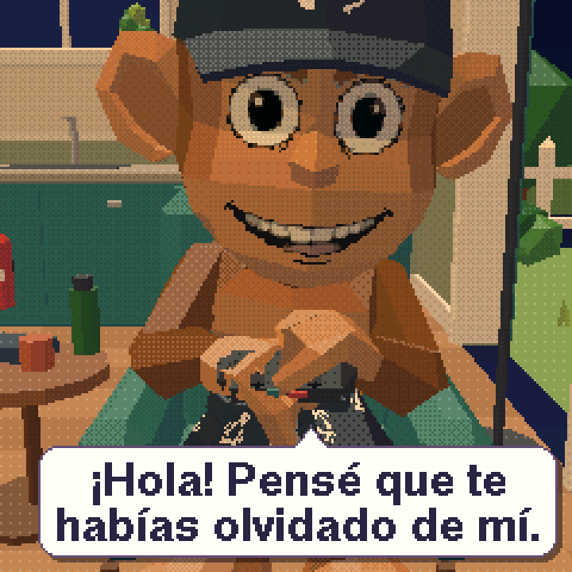
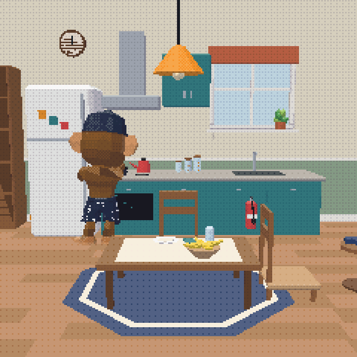
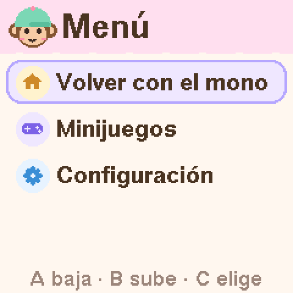
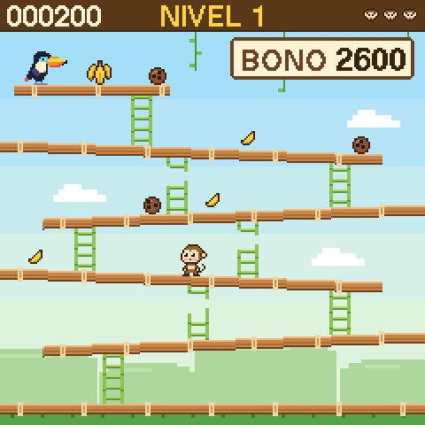

# 0xMono

Un mono que vive en una casa 3D dentro de un mini arcade de escritorio. Tiene rutina, opiniones sobre el mercado y un matafuego por las dudas. ESP32-C3, pantalla de 1,3" y Rust sin sistema operativo.

<table>
  <tr>
    <td></td>
    <td></td>
    <td></td>
    <td></td>
  </tr>
  <tr>
    <td align="center">Le hablás, contesta</td>
    <td align="center">Su casa, su agenda</td>
    <td align="center">El menú (A+C)</td>
    <td align="center">Cocos Rodantes</td>
  </tr>
</table>

No hay que alimentarlo ni limpiarlo: no es un Tamagotchi de los que se mueren. Se enchufa y hace su vida. Lo que se ve en la pantalla es un motor 3D por software corriendo en un microcontrolador de 160 MHz sin FPU.

## Qué hace

- **Vive según el reloj real.** Se levanta, desayuna, programa de 9 a 18, tiene reuniones, mira el mercado, toma mate, toca la guitarra, mira una película y sale al jardín a ver las estrellas antes de dormir. Sábados y domingos tienen otra forma.
- **26 actividades** en una casa con jardín y bananero. Camina esquivando muebles, corre la silla para sentarse, se acuesta de costado y agarra las cosas con la mano (cuchara, mate, guitarra, joystick, regadera, matafuego).
- **Nunca dos días iguales.** Cada mono nace de una semilla al azar (más dormilón, más deportista, más charlatán) y cada día tiene un humor distinto. La agenda se calcula, no se simula: si lo desenchufás un rato, al volver está haciendo lo que le tocaba.
- **Gags.** Durmiendo se tira pedos. Cocinando, a veces se prende fuego la olla: busca el matafuego, apaga y lo guarda. Haciendo ejercicio, transpira.
- **Luz según la hora.** Amanecer rosado, mediodía neutro, hora dorada, anochecer violeta, noche azul. De noche prende las lámparas; dormido, solo luz de luna.
- **Habla y piensa.** Tocás cualquier botón y contesta en un globo, moviendo la boca. Cada tanto piensa en voz alta (globo lila). Unas 650 frases escritas a mano que dependen de lo que está haciendo, la hora, el día, su humor y cómo viene el mercado.
- **Menú** con A+C mantenidos 2 s, desde cualquier lado.
- **Minijuego:** Cocos Rodantes. Un tucán se robó las bananas y tira cocos desde arriba de una torre de andamios.
- **Configuración desde el celular,** sin app ni cuenta: el mono arma su propia red WiFi, muestra un QR y la página se abre sola. Ahí se elige el WiFi, la zona horaria, "Mono nuevo" o "Restablecer de fábrica".
- **Hora automática.** No tiene batería: al enchufarlo se pone en hora por internet (SNTP). Sin WiFi, mantener B adelanta el reloj una hora.
- **Guarda en la flash** al mono, la hora y la configuración, con registros que sobreviven a un corte de luz a mitad de escritura. Grabar un firmware nuevo no lo borra.

## Manual de uso

Un cuadernillo A5 de 16 páginas, para el que lo tiene en el escritorio:

- [`0xMono-manual.pdf`](docs/manual/0xMono-manual.pdf): para leer en pantalla.
- [`0xMono-manual-imprimir.pdf`](docs/manual/0xMono-manual-imprimir.pdf): para imprimir. 4 hojas A4 doble faz, girando por el **borde corto**, al 100 %. Se ponen una dentro de otra, se doblan al medio y, si querés, dos broches en el lomo.

Detalles de impresión, papel y cómo rearmarlo en [`docs/manual/README.md`](docs/manual/README.md).

## Hardware

| Pieza | Notas |
|---|---|
| ESP32-C3 SuperMini | RISC-V a 160 MHz, 400 KB de RAM, 4 MB de flash, WiFi 2,4 GHz, USB-C. Lógica de 3,3 V. |
| Pantalla IPS 1,3" ST7789, 240×240, SPI | La de 7 u 8 pines (GND, VCC, SCL, SDA, RES, DC, BLK y a veces CS). |
| 3 pulsadores 6×6 mm de 2 patas | Sin resistencias: el ESP32 usa su pull-up interno. |
| Cables dupont macho-hembra y cable fino | El arnés, con empalmes soldados. |
| Cable USB-C de datos y un cargador de celular de 5 V | Alcanza con 1 A. |
| MDF de 5 mm, cola vinílica, 4 tornillos | La carcasa. Ver la guía. |
| *Opcional:* DY-SV17F, parlante de 8 Ω / 1 W, resistencia de 10 kΩ, condensador de 220–470 µF | Sonido. El original se armó sin él; el firmware lo soporta igual. |

Herramientas: soldador con temperatura regulable, estaño de 0,8 mm con flux, flux aparte, multímetro con continuidad (el que pita), alicate de corte y algo para cortar MDF.

### Conexiones

| Pieza | Pin | ESP32-C3 |
|---|---|---|
| Pantalla | VCC / GND | 3V3 / GND |
| Pantalla | SCL / SDA | GPIO6 / GPIO7 |
| Pantalla | DC / RES / BLK | GPIO5 / GPIO20 / GPIO21 |
| Pantalla | CS, si existe | GND |
| Botón A / B / C | una pata (la otra a GND) | GPIO3 / GPIO1 / GPIO0 |
| DY-SV17F (opcional) | V+ / GND | 5V / GND |
| DY-SV17F (opcional) | RX | GPIO10 (TX de la UART1). Su TX, **sin conectar**. |

### Seguridad

- Los GPIO son de **3,3 V**: nunca 5 V en un pin. Por eso del DY-SV17F solo va su RX.
- Cablear siempre **desenchufado**, y antes de enchufar medir continuidad entre 3V3 y GND y entre 5V y GND: si pita, hay un corto.
- El **orden de pines de la pantalla** cambia entre fabricantes: guiarse por la serigrafía, no por un dibujo. VCC y GND al revés la matan.
- No usar GPIO2, 8 ni 9 (arranque) ni 18 y 19 (USB). Los botones nunca se configuran como salida: apretados, serían un corto a GND.
- Parlante solo a SPK± del DY-SV17F, volumen inicial 15/30. Nunca enchufar el USB del DY-SV17F con la placa conectada.

### Alimentación

Solo USB-C, sin batería: el mismo conector alimenta y programa, así que no hay cargador de litio, interruptor ni diodo. Desenchufarlo no rompe nada: se apaga como cualquier aparato USB, el reloj se frena y al volver retoma (con WiFi, se pone en hora solo). Fijá la placa a la carcasa para que el USB-C no cargue con los tirones del cable. Algunos power banks se apagan solos con tan poco consumo. Si agregás sonido y la placa se reinicia cuando suena, el condensador va junto al módulo, entre 5V y GND.

### Guías de armado

Páginas HTML para abrir en el navegador (desde una copia del repo). Están escritas paso a paso para alguien que nunca soldó.

| Guía | Qué tiene |
|---|---|
| [Soldadura](docs/soldadura.html) | Aprender a soldar desde cero: práctica, los pines de la SuperMini y de la pantalla, errores comunes. |
| [Armado en protoboard](docs/armado.html) | Todo conectado en una protoboard de 30 números, agujero por agujero, para probar antes de soldar. |
| [Cableado final](docs/cableado.html) | El arnés cable a cable que va dentro de la caja, con los largos para el arcade, pruebas por etapa y el sonido "para más adelante". |
| [Carcasa](docs/carcasa.html) | El mini arcade de MDF: modelo 3D, medidas que se recalculan con tu pantalla y pasos de armado. |

## Grabar el firmware

Desde cero, en Linux, macOS o Windows:

1. **Rust:** instalarlo con [rustup](https://rustup.rs).
2. **espflash**, el programa que graba la placa:
   ```sh
   cargo install espflash --locked
   ```
   En Linux necesita antes `pkg-config` y `libudev-dev` (Debian/Ubuntu: `sudo apt install pkg-config libudev-dev`).
3. **Enchufar la placa** con un cable USB-C de datos (los de solo carga no sirven). En Linux aparece como `/dev/ttyACM0`; si espflash no tiene permiso, sumá tu usuario al grupo del puerto y volvé a iniciar sesión: `sudo usermod -aG dialout $USER` (en Arch, `uucp`).
4. **Compilar, grabar y mirar:**
   ```sh
   cd firmware
   cargo run --release
   ```
   `firmware/rust-toolchain.toml` le pide a rustup el target del ESP32-C3 (`riscv32imc-unknown-none-elf`) y `rust-src`; si tu rustup no los instala solo, `rustup target add riscv32imc-unknown-none-elf` y `rustup component add rust-src`. La primera compilación tarda unos minutos. Después graba por USB (a 80 MHz en modo DIO, ya configurado) y abre el monitor; Ctrl+C lo cierra. Si hay varios puertos, espflash pregunta cuál.

Qué tendrías que ver: la pantalla muestra la casa y en el monitor aparece algo como

```text
casa del mono: arrancando a las 08:00 (vie)
...
16 ms/fotograma, pila libre 8812 bytes
```

La línea de `ms/fotograma` se repite cada 300 fotogramas: si sale, el programa corre, aunque la pantalla esté negra (en ese caso, revisar sus cables).

**Primer arranque.** Sin nada guardado, nace un mono nuevo con personalidad al azar y cree que son las 8:00. Para ponerlo en hora: menú, Configuración, Desde el celular (WiFi y zona; a partir de ahí se pone en hora solo cada vez que se enchufa), o mantener B en la casa para sumar horas.

**Actualizar.** Grabar otra versión no toca el mono ni la configuración: viven en otra parte de la flash. `espflash erase-flash` sí borra todo.

**Si no conecta:** probar otro cable o puerto. Como último recurso, mantener BOOT en la SuperMini, tocar RESET, soltar BOOT y volver a correr `cargo run --release`.

Otros programas de la placa: `cargo run --release --bin bench_habitat` (tiempos del 3D, sin pantalla) y `--bin miner` (minería de Bitcoin experimental, ver [desarrollo](docs/desarrollo.md#modo-minero)).

## Probar en la PC (simulador)

El simulador corre el mismo código que la placa, en una ventana. Desde la raíz del repo (el `rust-toolchain.toml` de la raíz se encarga del toolchain):

```sh
cargo run -p simulator --release --example habitat   # la casa con la hora real. A/S/D = botones, T acelera (x60, x600, x3600),
                                                     #   H +1 hora, N mono nuevo, C cámara general, G un gag ya
cargo run -p simulator --example menu                # el menú y las pantallas (A/S/D; A+D 2 s = A+C)
cargo run -p simulator --example menu -- --serve     # la página de configuración en http://127.0.0.1:8080
cargo run -p simulator --release --example games     # Cocos Rodantes
cargo run -p simulator --example talk                # lo que dice y piensa en cada actividad
cargo run -p simulator --example week                # la agenda de la semana del mono guardado
cargo run -p simulator --release --example character # visor del personaje y sus animaciones
cargo test --workspace                               # los tests (unos 200)
```

`cargo run -p simulator` lista todos los ejemplos. En Linux, la ventana necesita las librerías de X11 o Wayland de cualquier escritorio. El hábitat guarda su mono en `companion.bin`, en la carpeta desde donde se corre.

## Estructura del repo

| Carpeta | Qué es |
|---|---|
| `firmware/` | El programa del ESP32-C3 (esp-hal + Embassy). Bin `casa` (el aparato, por defecto), `miner` (experimental) y benchmarks `bench*`. Fuera del workspace, con su propio toolchain. |
| `crates/companion/` | El personaje: agenda, actividades, personalidad, caras, frases y guardado. |
| `crates/habitat/` | Su vida en la casa: caminos, posturas, objetos en la mano, gags, luz, cámara y el globo. |
| `crates/engine/` | El motor 3D por software (`engine3d`). |
| `crates/ui/` | El menú y las pantallas de configuración y de la hora. |
| `crates/games/` | Los minijuegos. |
| `crates/fonts/` | Las letras de la pantalla (U8g2). |
| `crates/settings/` | La configuración: registro guardado, página para el celular, zonas horarias, SNTP, pedidos entre arranques. |
| `crates/captive/` | La red propia: HTTP mínimo, DNS cautivo, redes encontradas, QR. |
| `crates/sound/` | Las tramas del reproductor DY-SV17F. |
| `crates/miner/` | Modo minero (experimental). |
| `assets/` | El arte: personaje y casa exportados de Blender (`*.json`, `house.blend`), texturas, y el crate con los datos generados (`assets/src`). |
| `simulator/` | Ejemplos de escritorio con el mismo código que la placa. |
| `tools/` | Scripts de Blender y de Python que convierten el arte al formato del motor. |
| `docs/` | Guías de armado (HTML), el [manual](docs/manual/) y las [notas técnicas](docs/desarrollo.md). |

Todo lo de `crates/` es `no_std`, sin hardware y con tests.

## Cómo modificarlo

**Un minijuego nuevo.** En `crates/games/`: un módulo con su estado y tres métodos, `new(seed)`, `update(keys, dt_ms) -> Status` y `draw(&self, target)` (dibuja sobre cualquier `DrawTarget` de 240×240; en la placa se llama una vez por franja, así que no puede depender del orden de llamadas). Después, una variante en `GameId` (con su `title()` y en `GameId::ALL`) y otra en `Running`. El menú de minijuegos lista `GameId::ALL` y el firmware corre `Running`, así que aparece solo. Para probarlo en la PC, cambiar el `GameId` que arranca `simulator/examples/games.rs`. `Cocos` (`crates/games/src/cocos/`) sirve de modelo, tests incluidos.

**Una opción en el menú.** `crates/ui/src/menu.rs` es una lista de datos: se suma un `item("Texto", Icon::..., Go::...)` a `MAIN` o `SETTINGS`. Si abre una página, `Go::Open(PageId::...)`; si le pide algo al firmware, una variante nueva en `Action` y su caso en `firmware/src/bin/casa/house.rs`. Los tests verifican que el texto entre en pantalla. Se prueba con `--example menu`.

**Frases.** En `crates/companion/src/lines.rs`, una regla por línea: `s(CODE, "...")` para cuando le hablás, `t(...)` para lo que piensa solo, `st(...)` las dos. Se le pueden encadenar condiciones: `.h(9, 12)` (horario), `.wd()` / `.sat()` / `.sun()`, `.mood(...)`, `.up()` / `.down()` (el mercado), `.likes(Taste::Gamer, 60)`. Los huecos (`{coin}`, `{bug}`, `{next}`...) se llenan solos. `cargo test -p companion` controla que entren en el globo, y `--example talk` muestra cómo salen.

**La agenda y las actividades.** Los horarios, la forma de cada tipo de día y los pesos del tiempo libre están en `crates/companion/src/routine.rs`; dónde y cómo se hace cada actividad (lugar, postura, animación, objeto en la mano), en `crates/habitat/src/plan.rs`. Una actividad nueva toca `Activity` (y su lista `ALL`), la agenda, el plan, su emoción (`activity_emotion`) y, si querés, frases propias; los tests marcan lo que falte. `--example week` muestra la semana resultante.

**El personaje o la casa, desde Blender.** El arte se exporta a JSON con los scripts de `tools/blender/` y `python tools/build_assets.py` lo convierte a Rust (`assets/src/*.rs`). La casa está en `assets/house.blend`; del personaje está la exportación (`assets/mono.json`) y las texturas de la cara (`assets/face/`). El paso a paso, las convenciones y cómo volver a bajar las animaciones de Mixamo, en [desarrollo](docs/desarrollo.md#del-modelo-de-blender-al-juego).

**El manual.** Fuente en `docs/manual/manual.html`. `docs/manual/tools/screens.sh` y `renders.sh` vuelven a sacar las capturas del simulador y `docs/manual/build.sh` arma los dos PDF (instala WeasyPrint la primera vez). Detalles en [`docs/manual/README.md`](docs/manual/README.md).

## Detalles técnicos

En resumen: el WiFi y el 3D no entran juntos en los 320 KB de RAM, así que cada arranque es de un solo modo (casa, configuración u hora por internet) y para cambiar se reinicia con el pedido en la RAM del RTC. El motor dibuja en punto fijo, por franjas de 240×24 con z-buffer, y con la cámara quieta solo redibuja lo que cambió: 10–16 ms por fotograma en la placa. El guardado es un diario con CRC en dos sectores de la partición `nvs`. La configuración desde el celular usa un DHCP y un DNS cautivo propios, y la hora sale de SNTP.

Todo eso, con números, tablas y el pipeline del arte, en **[docs/desarrollo.md](docs/desarrollo.md)**.

## Licencia y créditos

[MIT](LICENSE), © 2026 FedeJure: todo lo del repo salvo lo de terceros que sigue.

De terceros:

- **Animaciones de [Mixamo](https://www.mixamo.com)** (Adobe), usadas bajo sus términos. El repo trae solo el resultado convertido; los FBX originales no se redistribuyen (ver [cómo bajarlos](docs/desarrollo.md#animaciones-mixamo)).
- **Tipografías del manual** (`docs/manual/fonts/`): Space Grotesk, Inter, JetBrains Mono y Nunito, con la SIL Open Font License (cada una con su `OFL-*.txt`).
- **Letras de la pantalla:** fuentes de U8g2 a través del crate `u8g2-fonts` (Helvetica de X11 y Free Universal, con sus licencias).
- **Crates de Rust** (esp-hal, Embassy, embedded-graphics, etc.), bajados por Cargo, cada uno con su licencia.
- Las guías HTML cargan tipografías de Google Fonts y three.js desde un CDN.
